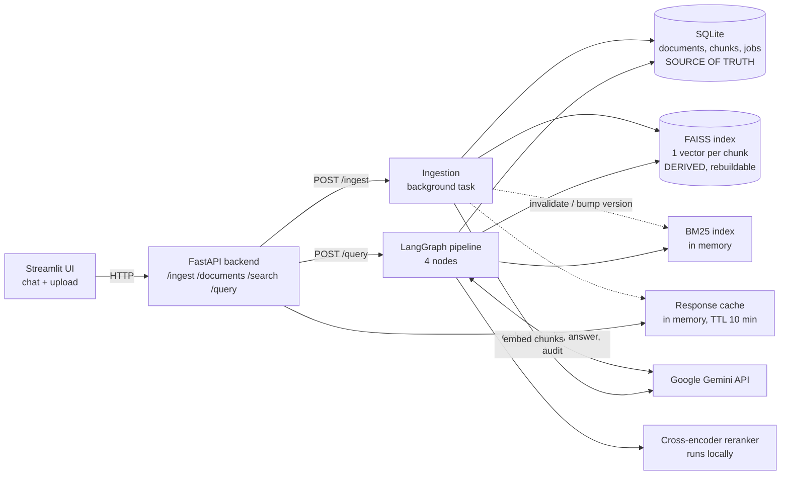
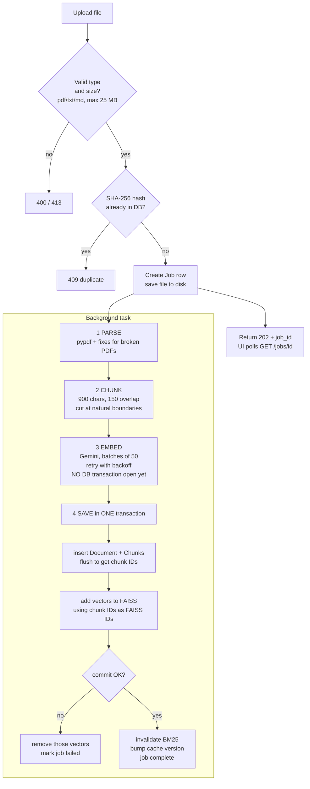
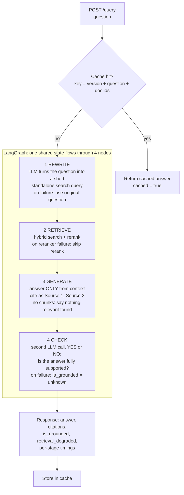
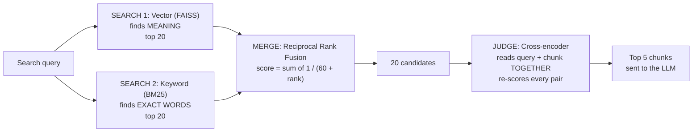
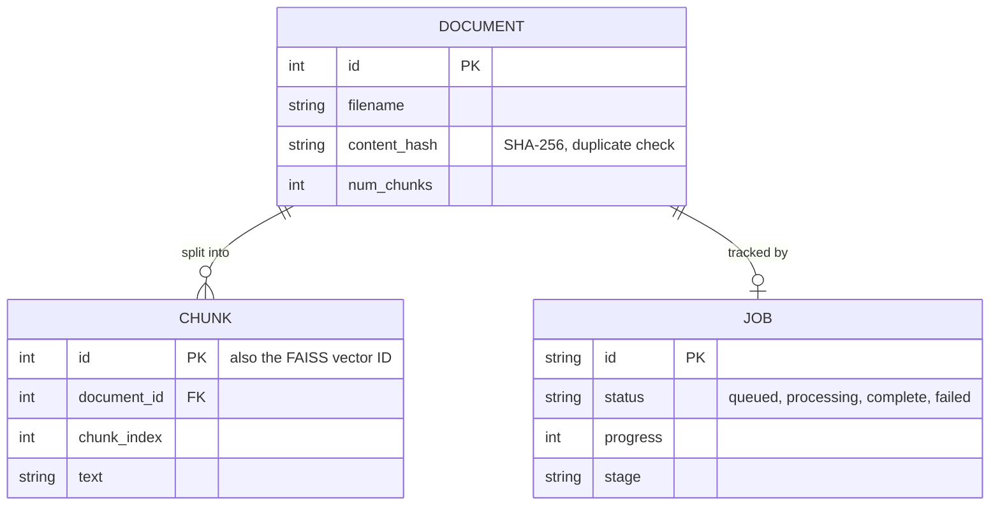
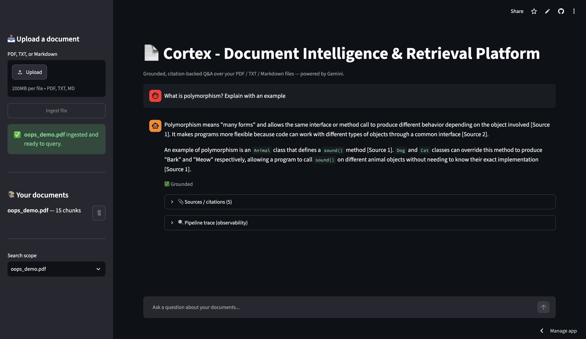
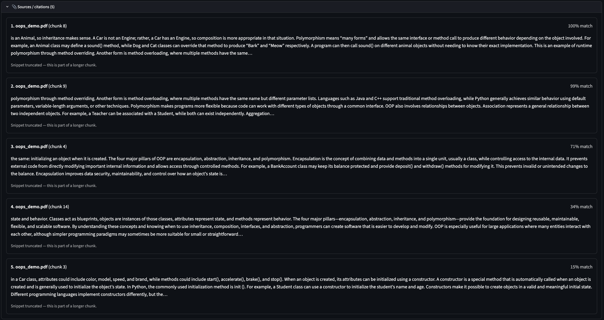
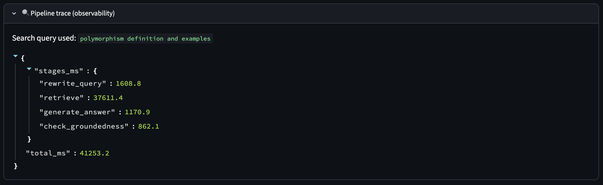

# Cortex - A Document Intelligence & Retrieval Platform

A grounded, citation-backed question-answering system over your own PDF, TXT
and Markdown files — built on FastAPI, Gemini, FAISS, BM25, a cross-encoder
reranker, and a LangGraph pipeline, with a Streamlit chat frontend.

Ask a question, and the system finds the exact passages that answer it,
cites them by source, and honestly says "I don't know" when your documents
don't contain the answer — instead of making something up.

## Why this project

Most RAG demos wire an embedding model to a vector database and call it
done. This one is built around a harder, more honest question: **how do you
know it's actually working, and how do you keep it working as data changes?**
That shows up in a few deliberate choices:

- **Hybrid retrieval, not just vectors.** Semantic (FAISS) and keyword
  (BM25) search are fused with Reciprocal Rank Fusion, then reordered by a
  cross-encoder. An evaluation run (`eval/run_eval.py`) measures the actual
  lift this gives over vector search alone — see [Evaluation](#evaluation).
- **Grounding is checked, not assumed.** Every answer is generated strictly
  from retrieved context with inline citations, then audited by a second,
  independent LLM call that flags unsupported claims.
- **Consistency is designed in, not patched on.** A chunk's database ID
  doubles as its FAISS ID, so vectors and text can never drift apart the way
  they would with a separate mapping table. Ingestion embeds *before*
  opening a database transaction, so a failure anywhere leaves either
  everything saved or nothing — never a half-saved document.
- **Failures are handled on purpose, not by accident.** Retryable API
  errors (rate limits, transient 5xx) are retried with backoff. A missing
  reranker degrades the pipeline one step (skips only that optimization)
  rather than failing the whole answer. A response cache is invalidated the
  moment the underlying documents change, so a stale answer is never served
  after new data arrives.

## Architecture

```
INGESTION (once per file)
  upload -> parse (PDF/TXT/MD) -> chunk (~900 chars, overlapping)
          -> embed (Gemini) -> save (SQLite text + FAISS vectors, atomically)

QUERY (every question)
  question -> rewrite (standalone search query)
           -> hybrid retrieve (FAISS + BM25 -> Reciprocal Rank Fusion -> cross-encoder rerank)
           -> generate answer (Gemini, grounded in retrieved chunks, cited)
           -> check groundedness (a second, independent LLM audit)
```

### 1. Big picture



Storage: SQLite holds the source of truth (documents, chunks, upload jobs).
FAISS holds one vector per chunk, keyed by the chunk's own database ID — a
derived index that can always be rebuilt from SQLite, never the reverse.

### 2. Ingestion pipeline (P-C-E-S)



**Why it's built this way**
- **Embed before the transaction.** The slow, failure-prone network step happens while no DB lock is held.
- **Chunk ID = FAISS ID.** No separate mapping table, so text and vectors cannot drift apart.
- **Undo on failure.** If the commit fails, the vectors are removed, so FAISS never keeps orphans.
- **Overlap (150 chars)** so a sentence cut at a chunk edge still appears whole in the next chunk.

### 3. Query pipeline (R-R-G-C)



### 4. Hybrid retrieval (2-1-1), the heart of the project



### 5. Data model



### 6. What happens when things fail

| Failure | Behaviour |
|---|---|
| Gemini 429 / 5xx | retried with exponential backoff and jitter |
| Rewrite call fails | falls back to the original question |
| Reranker can't load | skips only reranking, `retrieval_degraded = true` |
| Groundedness call fails | `is_grounded = null` (unknown), answer still returned |
| Commit fails mid-ingest | vectors removed, job marked failed |
| Server restarts mid-ingest | orphaned jobs marked failed on startup |
| Documents added or deleted | cache version bumped, so old answers can never match |
| FAISS and SQLite disagree | startup reconcile removes stray vectors and warns about missing ones |

---


## Tech stack

| Layer | Choice |
|---|---|
| API | FastAPI + Uvicorn |
| Database | SQLite via SQLModel |
| Embeddings & generation | Google Gemini (`gemini-embedding-2`, `gemini-3.1-flash-lite`) |
| Vector search | FAISS (`IndexFlatIP`, cosine similarity) |
| Keyword search | BM25 (`rank_bm25`) |
| Reranking | `cross-encoder/ms-marco-MiniLM-L-6-v2` |
| Orchestration | LangGraph |
| Frontend | Streamlit |
| Containers | Docker Compose |

## Screenshot





## Getting started

### Option A: Docker (recommended)

```bash
git clone https://github.com/d3byn/Cortex
cd Cortex
cp .env.example .env        # add your Gemini API key
docker compose up --build
```

Frontend: http://localhost:8501 · Backend docs: http://localhost:8000/docs

### Option B: Run locally

```bash
# Backend
cd backend
python3 -m venv .venv && source .venv/bin/activate
pip install -r requirements.txt
cp ../.env.example ../.env  # add your Gemini API key
uvicorn app.main:app --reload --port 8000

# Frontend (new terminal)
cd frontend
python3 -m venv .venv && source .venv/bin/activate
pip install -r requirements.txt
streamlit run app.py
```

Get a Gemini API key at https://aistudio.google.com/apikey.

## Evaluation

Fill in `eval/eval_dataset.json` with real questions about your own
documents, then, with the backend running:

```bash
cd eval
pip install -r requirements.txt
python run_eval.py
```

This reports Recall@5 for each of four retrieval modes (vector, keyword,
hybrid, hybrid + rerank), plus end-to-end accuracy, groundedness rate, and
per-stage latency for the full pipeline. My own run over N real questions:

```
=== Retrieval comparison (Recall@5: right document found in top 5?) ===
  vector          100.0%
  keyword         100.0%
  hybrid          100.0%
  hybrid_rerank   100.0%

=== End-to-end pipeline (hybrid_rerank + query rewrite + groundedness check) ===
  Questions run       : 15  (0 errored)
  Accuracy (proxy)    : 73.3%
  Grounded rate       : 80.0%
  Avg total latency   : 9353 ms
  Avg time per stage  :
    rewrite_query         2184.4 ms
    retrieve               805.5 ms
    generate_answer       3576.3 ms
    check_groundedness    2787.3 ms
```

## API reference

Full interactive docs at `/docs` once the backend is running. Key endpoints:

| Endpoint | Purpose |
|---|---|
| `POST /ingest` | Upload a file; returns a job id to poll |
| `GET /jobs/{id}` | Ingestion progress |
| `GET /documents` / `DELETE /documents/{id}` | List / remove documents |
| `POST /search` | Retrieval only, with a `mode` to compare strategies |
| `POST /query` | Full pipeline: rewrite, retrieve, answer, cite, ground |

## Project structure

```
doc-intel-platform/
├── backend/
│   └── app/
│       ├── api/          # FastAPI routers (ingest, documents, search, query)
│       ├── ingestion/     # parsing, chunking, background processing
│       ├── retrieval/     # embeddings, FAISS, BM25, fusion, reranking
│       ├── graph/         # LangGraph pipeline (nodes, state, wiring)
│       ├── cache/         # response cache
│       ├── db/            # SQLModel models + session
│       └── config.py, main.py, gemini_client.py, schemas/
├── frontend/
│   └── app.py             # Streamlit UI
├── eval/
│   ├── eval_dataset.json
│   └── run_eval.py
└── docker-compose.yml
```
