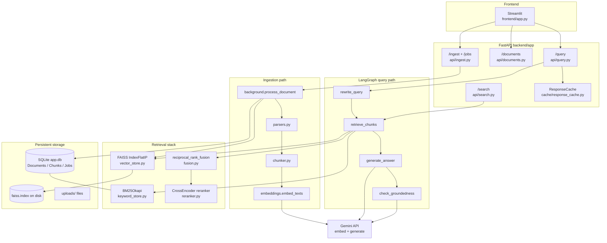

# 3–4. Architecture, tech stack, and RAG explained simply

← [Pitch](01-pitch-and-overview.md) · [Index](../CORTEX_GUIDEBOOK.md) · Next: [Walkthrough →](03-end-to-end-walkthrough.md)

---

## 3. Big picture

### Architecture diagram



### Tech stack table

| Technology | Purpose in Cortex | Why this choice (from the code / README intent) | Common alternatives |
|---|---|---|---|
| **FastAPI** + Uvicorn | HTTP API, OpenAPI docs, background tasks | Async-friendly Python API; natural fit for upload + JSON query | Flask, Django REST, NestJS |
| **Streamlit** | Chat UI, upload sidebar, citations | Fast demo UI without a JS frontend | Gradio, Next.js, plain HTML |
| **SQLModel** + **SQLite** | Source of truth for documents, chunks, jobs | Simple local persistence; no extra DB process | PostgreSQL, MySQL |
| **FAISS** (`IndexFlatIP`) | Exact vector similarity search | Fast in-process ANN/exact search; free; easy to ship | Chroma, Pinecone, pgvector, Weaviate |
| **rank_bm25** (BM25Okapi) | Keyword / sparse retrieval | Catches exact names and codes vectors may miss | Elasticsearch, OpenSearch |
| **sentence-transformers CrossEncoder** | Rerank candidate chunks | Scores query+passage together for better precision | Cohere Rerank, bge-reranker |
| **Google Gemini** (`google-genai`) | Embeddings + answer generation + groundedness | One vendor for embed + generate; used via API key | OpenAI, Claude, local models |
| **LangGraph** | Wire the 4 query stages as a graph | Clear stage boundaries + easy to extend | Plain functions, LangChain LCEL, custom DAG |
| **pypdf** | Extract text from PDFs | Lightweight PDF text extraction | pdfplumber, PyMuPDF |
| **Docker Compose** | Run API + UI together | Reproducible local demo | bare venv, k8s |
| **Pydantic / pydantic-settings** | Request schemas + env config | Validation + typed settings | plain `os.environ` |
| **NumPy** | Vector arrays for FAISS / BM25 | Standard numeric glue | — |

**Models (defaults in `backend/app/config.py`):**

| Setting | Default |
|---|---|
| Generation | `gemini-3.1-flash-lite` |
| Embedding | `gemini-embedding-2` |
| Reranker | `cross-encoder/ms-marco-MiniLM-L-6-v2` |

**Embedding dimensions:** not hardcoded. Cortex takes whatever length Gemini returns and builds the FAISS index from the first batch (`vector_store.add`). If you later change embedding models and the size differs, add() raises and tells you to delete `backend/storage/` and re-upload.

---

## 4. RAG explained simply

### What is RAG?

1. **Definition:** RAG means **Retrieval-Augmented Generation** — before the LLM answers, you *look up* relevant text from your documents and put that text into the prompt.  
2. **Analogy:** Like an open-book exam. The model is not forced to answer from memory alone; it can look at the pages you hand it.  
3. **Tiny example:**  
   - Input question: “What is encapsulation?”  
   - Retrieved chunk: “Encapsulation means controlling access to internal data…”  
   - Prompt to LLM: “Answer using ONLY this context: …”  
   - Output: answer that cites that chunk.  
4. **How Cortex uses it:** Upload path fills SQLite + FAISS (`background.process_document`). Query path retrieves chunks (`hybrid.retrieve` via `nodes.retrieve_chunks`) then generates (`nodes.generate_answer`).  
5. **Why it matters:** Without retrieval, the model guesses from training data and can hallucinate about *your* files.

### Why not just use an LLM alone?

| LLM alone | LLM + RAG (Cortex) |
|---|---|
| Does not know your private PDF | Can search your uploaded text |
| May invent confident wrong answers | Prompt says: only use CONTEXT; else say you don’t know |
| No citation to your file | Returns `citations` with filename + chunk text |
| Knowledge cutoff / generic | Grounded in the documents you ingested |

Cortex still *can* hallucinate if retrieval is wrong or the model ignores instructions — that is why there is a **groundedness check** (`check_groundedness`).

### Full Cortex pipeline (query)

```
Question
  → rewrite_query          (Gemini: short search query)
  → hybrid retrieve        (embed query → FAISS + BM25 → RRF → cross-encoder)
  → generate_answer        (Gemini: answer from CONTEXT + [Source N] citations)
  → check_groundedness     (Gemini: YES/NO audit)
  → QueryResponse          (+ cache, + stage timings)
```

Wired in ⭐ `backend/app/graph/pipeline.py` and implemented in ⭐ `backend/app/graph/nodes.py`.

### Hard concepts (interview-ready mini-lessons)

#### Embeddings

1. **Definition:** An embedding turns text into a list of numbers (a vector) so “similar meaning” becomes “nearby in space.”  
2. **Analogy:** Giving every sentence GPS coordinates — similar ideas live in the same neighborhood.  
3. **Example:** `"bank account object"` and `"represent a bank account in OOP"` → two vectors with high cosine similarity.  
4. **Cortex:** `embed_texts` / `embed_query` in `backend/app/retrieval/embeddings.py`; model from `settings.gemini_embedding_model`. Document texts get a `"title: none | text: …"` prefix for `gemini-embedding-2`; queries get `"task: question answering | query: …"`.  
5. **Without it:** You cannot do semantic search — only exact keyword matching.

#### Vector search (FAISS)

1. **Definition:** Find the stored vectors closest to the query vector.  
2. **Analogy:** “Find the 20 books on the shelf whose topic coordinates are nearest to my question.”  
3. **Example:** Query vector → top chunks with scores like `0.82`, `0.77`, …  
4. **Cortex:** `VectorStore.search` in ⭐ `backend/app/retrieval/vector_store.py` uses `IndexFlatIP` after L2-normalizing vectors, so inner product ≈ **cosine similarity**.  
5. **Without it:** Semantic matches (different words, same meaning) are missed.

#### Chunking

1. **Definition:** Splitting a long document into smaller pieces that fit retrieval and the prompt.  
2. **Analogy:** Cutting a textbook into flashcards so you can find the right card, not the whole book.  
3. **Example:** 10,000-char PDF → ~12 chunks of ~900 chars with 150-char overlap.  
4. **Cortex:** `chunk_text` in `backend/app/ingestion/chunker.py`; defaults `chunk_size=900`, `chunk_overlap=150` in ⭐ `config.py`. Cuts prefer paragraph / sentence boundaries.  
5. **Without it:** Embeddings smear a whole book into one vector, or the prompt overflows.

#### Hybrid search + RRF

1. **Definition:** Combine semantic results and keyword results into one ranking.  
2. **Analogy:** Asking both a librarian who understands topics *and* one who looks up exact titles, then merging their top lists.  
3. **Example:** Vector finds “OOP pillars”; BM25 finds the exact phrase “Single Responsibility Principle”; fusion keeps both near the top.  
4. **Cortex:** `retrieve` in ⭐ `hybrid.py` + `reciprocal_rank_fusion` in `fusion.py` (`score += 1/(k+rank)`, default `k=60`).  
5. **Without it:** Exact codes/names often fail with vectors alone; paraphrases fail with keywords alone.

#### Reranking (cross-encoder)

1. **Definition:** A second model that scores each *(query, chunk)* pair together and reorders candidates.  
2. **Analogy:** First cast a wide net (cheap search), then carefully read the top 20 fish and pick the best 5.  
3. **Example:** 20 fused candidates → cross-encoder scores → top 5 passed to the LLM.  
4. **Cortex:** `Reranker.rerank` in `backend/app/retrieval/reranker.py`; model `cross-encoder/ms-marco-MiniLM-L-6-v2`. Query path uses `top_k_candidates=20` then `top_k_final=5`.  
5. **Without it:** More irrelevant chunks enter the prompt → worse answers and more hallucinations.

#### Prompt construction

1. **Definition:** Building the exact text you send to the LLM (instructions + context + question).  
2. **Analogy:** Writing exam instructions and attaching the open-book pages.  
3. **Example:** `"Answer using ONLY the CONTEXT… [Source 1 - file.pdf]\n…\nQUESTION: …"`  
4. **Cortex:** `generate_answer` in ⭐ `nodes.py`.  
5. **Without it:** The model has no grounding rules and no citations format.

#### Hallucination + groundedness

1. **Definition:** Hallucination = the model states something not supported by the given evidence. Groundedness = every claim is supported by the retrieved context.  
2. **Analogy:** A student inventing a quote vs. a student who only uses the textbook page you gave them.  
3. **Example:** Context only discusses OOP; answer claims “Python was invented in 1991” → groundedness check should return NO.  
4. **Cortex:** `check_groundedness` asks Gemini for exactly `YES` or `NO`; result becomes `is_grounded` on `QueryResponse`.  
5. **Without it:** You ship fluent but unsupported answers with no alarm light.

#### Async / background work

1. **Definition:** Do slow work after quickly acknowledging the request.  
2. **Analogy:** Restaurant takes your order number now; kitchen cooks while you wait and check status.  
3. **Example:** `POST /ingest` → `202` + `job_id` → poll `GET /jobs/{id}` until `complete`.  
4. **Cortex:** FastAPI `BackgroundTasks` → `process_document` (`api/ingest.py`, `ingestion/background.py`).  
5. **Without it:** Uploads would block the HTTP request for the whole embed time.
