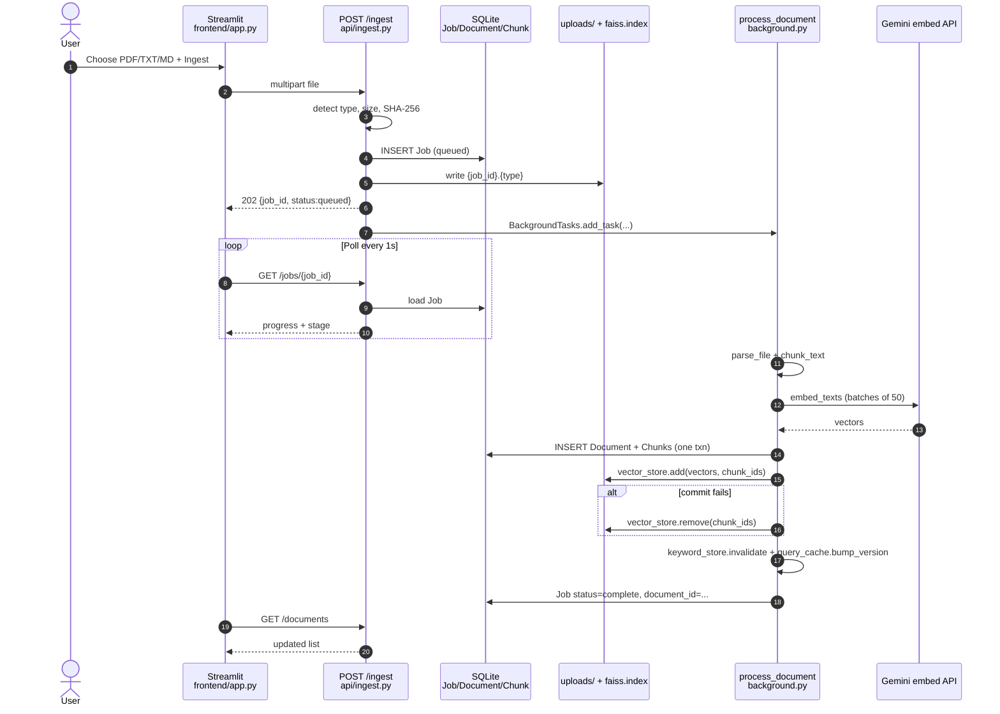
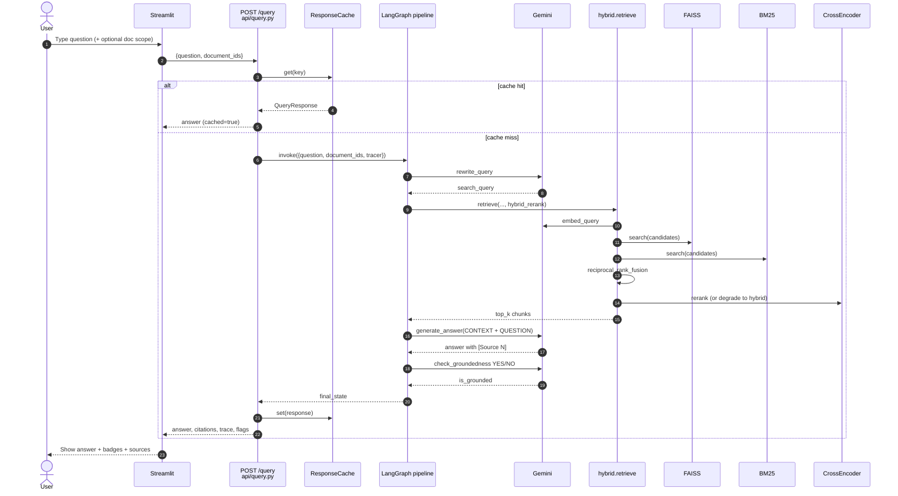

# 6–7. Project structure and data-flow diagrams

← [Walkthrough](03-end-to-end-walkthrough.md) · [Index](../CORTEX_GUIDEBOOK.md) · Next: [Design & setup →](05-design-challenges-setup.md)

---

## 6. Project structure (folder-by-folder)

```
/
├── README.md                 # Product pitch, architecture summary, how to run
├── .env.example              # GEMINI_API_KEY + model name overrides
├── .gitignore                # .env, venvs, backend/storage/, eval/results/
├── docker-compose.yaml       # backend :8000 + frontend :8501
├── .devcontainer/            # Codespaces-oriented Streamlit setup
├── backend/
│   ├── Dockerfile
│   ├── requirements.txt
│   └── app/
│       ├── main.py           # FastAPI app, lifespan, routers, health
│       ├── config.py         # ⭐ settings
│       ├── gemini_client.py  # shared Gemini client + generate_with_retry
│       ├── api/              # HTTP routers
│       ├── ingestion/        # parse, chunk, background job
│       ├── retrieval/        # embed, FAISS, BM25, fusion, rerank, lookup
│       ├── graph/            # LangGraph state, nodes, compile
│       ├── db/               # SQLModel models + engine
│       ├── cache/            # in-memory query response cache
│       ├── tracing/          # stage timers
│       └── schemas/          # Pydantic API models
├── frontend/
│   ├── Dockerfile
│   ├── requirements.txt
│   └── app.py                # Streamlit UI
├── eval/
│   ├── eval_dataset.json
│   └── run_eval.py
└── docs/                     # this guidebook
```

### Key-file map (what ↔ what)

| File | Does | Connects to |
|---|---|---|
| ⭐ `backend/app/config.py` | Loads `.env`, paths, chunk/top-k knobs | Almost everything |
| `backend/app/main.py` | Startup: DB init, FAISS reconcile, reranker warm-up | All routers |
| `backend/app/api/ingest.py` | Accept upload, dedupe, queue job | `background.process_document` |
| ⭐ `backend/app/ingestion/background.py` | Parse→chunk→embed→atomic save | parsers, chunker, embeddings, vector_store, keyword_store, cache |
| `backend/app/ingestion/parsers.py` | PDF/TXT/MD → clean text | pypdf |
| `backend/app/ingestion/chunker.py` | Text → list[str] | settings.chunk_* |
| ⭐ `backend/app/api/query.py` | Cache + invoke graph | `compiled_pipeline`, ResponseCache, Tracer |
| ⭐ `backend/app/graph/nodes.py` | Four RAG stages | gemini_client, hybrid.retrieve, settings |
| `backend/app/graph/pipeline.py` | LangGraph edges | nodes |
| ⭐ `backend/app/retrieval/hybrid.py` | Mode switch + fuse + rerank | vector_store, keyword_store, fusion, reranker, lookup |
| ⭐ `backend/app/retrieval/vector_store.py` | FAISS persistence | embeddings output, Chunk.id |
| `backend/app/retrieval/keyword_store.py` | BM25 over SQLite chunks | Chunk table |
| `backend/app/retrieval/embeddings.py` | Gemini vectors | gemini_client, settings |
| `backend/app/retrieval/reranker.py` | Cross-encoder | sentence-transformers |
| `backend/app/db/models.py` | Document / Chunk / Job | session.engine |
| `backend/app/cache/response_cache.py` | TTL + versioned keys | query + ingest/delete |
| `frontend/app.py` | Human UI | All HTTP endpoints |
| `eval/run_eval.py` | Measure retrieval + E2E | `/search`, `/query` |

### ⭐ Must-know six (again)

1. `backend/app/graph/nodes.py`  
2. `backend/app/retrieval/hybrid.py`  
3. `backend/app/ingestion/background.py`  
4. `backend/app/retrieval/vector_store.py`  
5. `backend/app/api/query.py`  
6. `backend/app/config.py`  

---

## 7. Data flow diagrams

### (a) Uploading a document



### (b) Asking a question


